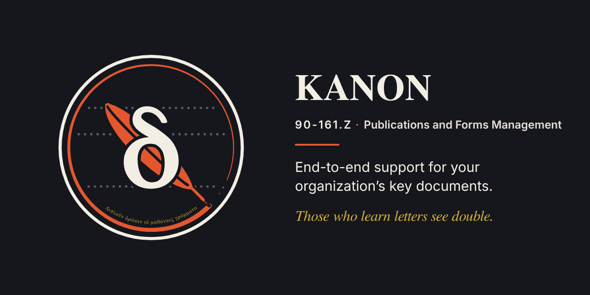

# Kanon

<b>Publications and Forms Management</b>

<!-- site:intro -->
Track and manage DAF publications through the DAFMAN 90-161 publishing process at wing/installation level: status tracking, document cleanup and formatting, and endorsement routing. See who has each publication or form, which endorsements are in, and what is due next. The PFM works in one window on the work computer (first test in R41); AOs and endorsers will answer in SharePoint forms from an e-mail link (planned). It runs in your wing's own SharePoint site and Power Automate, and RADE will install it (in progress).
<!-- /site:intro -->

> [!NOTE]
> Kanon is in test rounds with fake data. Parts marked (planned) are designed but not built yet.

---

### 🔺 Summary

<!-- site:key-facts -->
<table>
<tr><td><b>By the book:</b></td><td>every stage and format rule cites its DAFMAN 90-161 paragraph; each time limit comes from DAFMAN 90-161 or a recorded PFM decision.</td></tr> <!-- source: AGENTS.md "Source authority"; docs/DECISIONS.md -->
<tr><td><b>Endorsements:</b></td><td>flows make the endorsement rows and send the reminders and escalations; the answer path for endorsers (first test in R41) and the optional wave (planned).</td></tr> <!-- source: flow F05 (rows), F03 (reminders, escalation); flow/solution/README.md open point d (answer path not built) -->
<tr><td><b>System of record:</b></td><td>endorsements are kept here, not in TMT.</td></tr> <!-- source: AGENTS.md "Scope" -->
<tr><td><b>Clean drafts:</b></td><td>any draft becomes a correctly formatted final; the format comes from code, never from an AI model. (planned)</td></tr> <!-- source: AGENTS.md "Source authority"; docs/ARCHITECTURE.md section 5 -->
<tr><td><b>Reviews:</b></td><td>periodic reviews open on their own; special reviews, and a rescind action when no answer comes by the due date (planned).</td></tr> <!-- source: flow F02 (R37 test passed); docs/DECISIONS.md 2026-11-12 (5A) -->
<tr><td><b>Boundary:</b></td><td>nothing leaves DoD365 and GenAI.mil, except the PFM's round results e-mail until the pilot starts.</td></tr> <!-- source: AGENTS.md "Data boundary" -->
<tr><td><b>Access:</b></td><td>your own account; standard connectors; no tenant admin, no service account.</td></tr> <!-- source: AGENTS.md "Platform" -->
<tr><td><b>Install:</b></td><td>in progress: one paste in RADE for the scripts and lists, the flows imported by hand, and a tested fallback for each step that needs extra rights.</td></tr> <!-- source: AGENTS.md "Deployable package"; docs/setup-and-updates.md section 2 -->
<tr><td><b>Verifiable:</b></td><td>read the commented code as plain text before you paste it.</td></tr> <!-- source: AGENTS.md "Code standard"; the "Open the script" link (a .txt file) -->
</table>

> Have concerns? Ask in the Teams channel **RHOPE-OPS**.
<!-- /site:key-facts -->

---

<!-- >>> tasks: generated from go.md and the round bundle by scripts/build_readme.py (do not edit) -->
[**Open the script**](https://raw.githubusercontent.com/rhope-ops/90-161.Z/main/scripts/gov/paste/90161Z-R42-round-r2.txt)

The steps to run it are at the top of the script.

**Round script:** `90161Z-R42-round-r2.txt` · **Code:** `df7bc454380b...63f8`

---

### 🔺 Current tasks

Updated: 24 Nov 26 (R42 is ready).\
github.com/rhope-ops/90-161.Z

Every task below has the same parts: **For** (why), **Time** (an estimate), **Changes** (what it writes or changes, before I start), **Steps**, **Report** (what to send back) and **If it fails**.\
Reload this page to see new tasks (GitHub can serve a copy up to 5 minutes old).\
Never send real publication content, names, site addresses or group names. Reply in the Claude chat or by e-mail.

#### How a paste task (round) works

**For:** a round is one block of text I paste into PowerShell ISE. It opens the RADE window (Redacted Application Deployment Engine, formerly the 90-161.Z Deployer), saves its own files, runs the tests and makes the results e-mail. The ISSM allows this for scripts that use no elevated credentials (13 Nov 26).\
**Changes:** it writes only into my own OneDrive folder RADE\90-161.Z (the window shows the full path in bold): the task folders it needs (for example T01), Config and its results folder Rounds\\<round>. RADE\Config holds RADE's own settings: the results e-mail address and the saved checks (rade-checks.json: most checks that passed are not run again for 7 days). From R17 on, RADE moves my old OneDrive folder 90-161.Z into RADE once, when I select Run (one folder move; every file keeps its place). It makes missing folders and replaces files of the same name. From R06 on it also moves finished files to the Recycle Bin (only files 90-161.Z made). Before Run, the window lists every file, marked New, Replace or Recycle. Every file a task needs comes inside the round: there are no separate downloads (14 Nov 26). The .txt copy of the script (**Open the script**) is not a task file. A step marked "(needs you)" opens a small window with numbered steps for work in another program, such as a flow import.\
Steps to start a round. Do these steps when an open task on this page says "run the round". That task gives the round name, for example **R42**:
1. On GitHub, on the page **rhope-ops/90-161.Z**, find **Round script** under **Open the script**. You see the round name, for example `90161Z-R42-round-r2.txt`. Go on.
2. If the round name is not the round of the open task, do not open the script. You see the other round name next to **Round script**. Write down `README shows another round`. Send it to Claude with the steps "Send a line to Claude" on this page.
3. If the round name is right, click **Open the script**. You see the script as plain text on a new page, with the steps to run it at the top. Go on.
4. On the new page, do these actions:
   1. Press `Ctrl+A`.
   2. Press `Ctrl+C`.
   You see all the text in blue. `Ctrl+C` puts the text on the clipboard. Go on.
5. Click the Windows **Start** button. You see the search box. Go on.
6. Type `ISE`. You see **Windows PowerShell ISE** in the list. Go on.
7. Click **Windows PowerShell ISE**. Do not click **Run as administrator**. You see the window **Windows PowerShell ISE**. Go on.
8. In the window **Windows PowerShell ISE**, do these actions:
   1. Click **File**.
   2. Click **New**.
   You see a new white script pane. Go on.
9. In the white script pane, press `Ctrl+V`. You see the script text in the pane. Go on.
10. Press `F5`. You see the window **RADE**, red text in ISE, or the round steps as text in ISE. Wait until one shows (up to 2 minutes, an estimate).
11. If nothing shows after 2 minutes, write down `Nothing after F5`. Send it to Claude with the steps "Send a line to Claude" on this page. Wait until Claude answers.

Steps to send a line to Claude. Do these steps when a step on this page says "Send it to Claude":
1. On your phone, open the Claude chat of 90-161.Z. You see the chat. Go on.
2. In the chat, type the text that the step gave you. You see the text in the message box. Go on.
3. Press **Send**. You see your message in the chat. Wait until Claude answers. Do not run the round again until then.
4. Read the answer of Claude in the chat. You see the next action in the answer. Do that action. The task is complete.

Steps if the window **RADE** opens:
1. In the window **RADE**, find the bold line **Writes to**. You see your OneDrive folder **RADE\90-161.Z**, or the words **NOT found**. Go on.
2. If you see **NOT found**, do not click **Run**. Write down `Writes to: NOT found`. Send it to Claude with the steps "Send a line to Claude" on this page. The steps in this window stop here.
3. If the box **Send results to** is empty, type your own e-mail address. You see the address in the box. Go on.
4. In the window **RADE**, click **Run**. You see the steps run in the log. Wait until the log shows `DONE` or the card **Stopped** shows (up to 1 hour, an estimate). Do not close the window until then.
5. If the card **Stopped** shows, write down the first 10 words of its text. Do not write down names or site addresses. Send them to Claude with the steps "Send a line to Claude" on this page. Wait until Claude answers. The steps in this window stop here.
6. If the log shows a line that starts with **What to do**, do the action on that line. You see the log go on. Wait until the log shows `DONE`.
7. When the log shows `DONE`, you see an Outlook draft, or the results folder in File Explorer. Wait until one shows (up to 2 minutes, an estimate).
8. If you see the Outlook draft, its **To** line shows the address from the box **Send results to**. In the draft, click **Send**. The draft closes. The task is complete.
9. If you see the results folder and no draft, send the results with the steps "Send the results by hand" on this page. Go on.

Steps if ISE shows red text:
1. In the blue pane of ISE, find the first line in red. You see red text. Write down the first 10 words of that line. Do not write down names or site addresses.
2. Send the 10 words to Claude with the steps "Send a line to Claude" on this page. Wait until Claude answers. You see the answer of Claude in the chat.

Steps if the round steps show as text in ISE:
1. Look at the blue pane of ISE. You see the steps run. Wait until the pane shows `DONE` (up to 1 hour, an estimate). Do not close ISE until then.
2. When the pane shows `DONE`, you see the results folder open in File Explorer. Send the results with the steps "Send the results by hand" on this page. Go on.

Steps to send the results by hand. Do these steps when no Outlook draft opens and you see the results folder in File Explorer. RADE puts the e-mail text on the clipboard. RADE makes no zip file:
1. Put the File Explorer window of the results folder and Outlook side by side. You see both windows. Go on.
2. In Outlook, click **New**, the button that starts a new e-mail. You see a new e-mail window. Go on.
3. In **To**, type your own e-mail address. You see the address in **To**. Go on.
4. Click in the body. You see the cursor in the body. Go on.
5. Press `Ctrl+V`. You see the e-mail text in the body. Its first line is the subject, for example `90161Z R42 PASSED`. Go on.
6. Select the first line of the body with the mouse, from the first word to the end of the subject. You see the line in blue. Go on.
7. Press `Ctrl+X`. You see the first line go away. Go on.
8. Click in **Subject**. You see the cursor in **Subject**. Go on.
9. Press `Ctrl+V`. You see the subject line in **Subject**. Go on.
10. Click the File Explorer window. You see the files of the results folder. Go on.
11. Press `Ctrl+A`. You see all files in blue. Go on.
12. Drag the files into the body of the e-mail. You see the files as attachments. Go on.
13. Click **Send**. The e-mail closes. The task is complete.

**If it fails:** the window shows a line that starts with "What to do" under the problem: do that. Otherwise send the line that starts with STOPPED. The report file in Rounds\\<round> also holds it. Do not work around it. If no window opens, the same steps run as text in ISE and the results folder opens by itself.\
The script never sends the e-mail; the draft waits in Outlook. Finished task folders are cleaned up by the rounds; a later round makes any folder it needs again. Keep T07 if it holds 90161Z-T07-key-r1.txt (rounds never touch it).\
Sensitivity label: every render gets the label from Config\90161Z-label.json. Never delete the Config folder: without it, renders print "LABEL not set" and have no label. The file I labeled by hand is no longer needed. If Config is lost, run a round, then capture again from its new render (it is already labeled); label a file by hand again only if renders say LABEL FAIL.

#### Open tasks

##### Round R42 r2: my window r15, an endorser answer, a small sign-in window and Restore

**For:** the round after R41. It tests the R41 fixes: my 90-161.Z window r15 (room for the scroll bar; the screens Waves and Step 13 open), the answer of a second person, a small CAC sign-in window for Back up and Restore, and RADE Restore of fake rows with their old row numbers. The first RADE window shows **90-161.Z R42** at the top. The second RADE window (from the RADE shortcut) shows **90-161.Z 0.1.0** at the top.\
**Time:** about 40 minutes, with about 5 minutes of a second person from my office (an estimate).\
**Changes:** on my computer: my OneDrive folder RADE\90-161.Z (scripts and result files in T21, T22 and T26, 17 pictures of the window screens, and one backup of the 12 test site lists). The old files of T21 r11, T22 r14 and T26 r1 go to the Recycle Bin. The Repair saves a new copy of RADE for the RADE shortcut. On the test site: a test list and library, the second person in the Visitors group, one fake publication and fake endorsement rows. The last steps of the round move them to the site Recycle Bin. Before Run, the window lists every file.\
**Steps:**
1. Ask one person of your office to help in this task (about 5 minutes, an estimate). You see that the person agrees. Write down the e-mail address of that person.
2. Do "Steps to start a round" on this page with the round name **R42**. Wait until you see the window **RADE**.
3. In the window **RADE**, click **90-161.Z 0.1.0**. Wait until you see **90-161.Z 0.1.0** at the top and the button **Repair**.
4. Click **Repair**. You see the log. Wait until the log shows `DONE` (up to 5 minutes, an estimate).
5. In the window **RADE**, click **Close**. Wait until you see ISE with the script in the white pane.
6. In ISE, press `F5`. You see the window **RADE** again. Wait until it shows (up to 2 minutes, an estimate).
7. In the window **RADE**, click **90-161.Z R42**. Wait until you see **90-161.Z R42** at the top and the button **Run**.
8. If the bold line **Writes to** shows **NOT found**, do not click **Run**. Do "Send a line to Claude" on this page with the line `Writes to: NOT found`. The steps of this task stop here.
9. If the box **Send results to** is empty, type your own e-mail address. You see the address in the box. Go on.
10. In the window **90-161.Z R42**, click **Run**. Wait until you see the log.
11. If a CAC sign-in window opens, sign in with your CAC. You see the log again. Go on.
12. If the window **90-161.Z test T4** asks for an e-mail address, type the address that you wrote down. You see the address in the box. Go on.
13. If the window **90-161.Z test T4** shows your address in the box, click **OK**. The window closes. Go on.
14. Each time a card shows in the window **90-161.Z R42**, do the numbered lines on that card. Wait until you see the last line of the card.
15. Each time a card shows the button **Done**, click **Done**. Wait until you see the next card or a question.
16. Each time a question shows in the window **90-161.Z R42**, click your answer. Wait until you see the next card or question.
17. Each time the bottom bar of the window **Publications and Forms Management** shows a line, do what the line says. Wait until you see the screen that it names.
18. If the bottom bar shows **Screen 10 of 17**, look at the grid **Wave 1 answers**. Write down `Yes` if it shows the second person, else `No`.
19. If the screen is right, click **Pass** in the bottom bar (else **Fail**). Wait until you see the next line of the bar.
20. If the bottom bar has no line after **Screen 17 of 17**, close the window **Publications and Forms Management** with its X. You see the window **90-161.Z R42**. Go on.
21. If the log shows `DONE` and you see an Outlook draft, click **Send** in the draft. The draft closes. Go on.
22. If the log shows `DONE` and no Outlook draft shows, do "Send the results by hand" on this page. You see the e-mail close. Go on.
23. If the card **Stopped** shows, do "Send a line to Claude" on this page with the first 10 words of the card. The steps of this task stop here.
24. Do "Send a line to Claude" on this page with the line `R42 sent`. You see your line in the chat. The task is complete.

**Report:** send the Outlook draft that the round makes. Its subject is `90161Z R42 PASSED` or `90161Z R42 NEEDS REVIEW`, and it has every file of the results folder.\
**If it fails:** in the log of the window **90-161.Z R42**, do the line that starts with **What to do**. If the button **Repair** does not show, write down the button text that shows. Send it to Claude with the steps "Send a line to Claude" on this page. If the second person cannot help today, click **Skip** on that card. The round goes on and removes the test rows at the end.
<!-- <<< tasks -->

---

### 🔺 How it works

<kbd>Review due</kbd> → <kbd>AO named</kbd> → <kbd>Draft</kbd> → <kbd>PFM formats</kbd> → <kbd>Privacy review</kbd> → <kbd>Endorse</kbd> → <kbd>Legal</kbd> → <kbd>Certify</kbd> → <kbd>Approve</kbd> → <kbd><b>Publish</b></kbd>

Built today: Review due (periodic reviews open on their own, flow F02). In progress: Endorse and Legal (flows make the endorsement rows and send reminders; the answer path is first tested in R41). Planned: every other step.

#### Who uses what

The design; parts marked (planned) are not built yet.

| Person | Uses | To |
|---|---|---|
| PFM | The 90-161.Z window on the work computer | See every action (read-only; first test in R41); start endorsement, format drafts and change who gets a step (planned) |
| OPR mailbox | A SharePoint form from an e-mail link (planned) | Name 1 or 2 AOs (planned) |
| AO | A SharePoint form from an e-mail link (planned) | Answer "needs further review?", add endorsers, fill in the DAF Form 673 (planned) |
| Endorser | The SharePoint list form (first test in R41); an e-mail link to it (planned) | Answer the endorsement, read the final draft and comment (planned) |
| Certifier, approver | The PFM or their CSS records the signature (planned) | Certify and approve (planned) |

#### What it keeps

| List | One row per |
|---|---|
| PFM Publications | Action on a publication or form (new, rewrite, change, certify current, rescind, transfer) |
| PFM Endorsements | Endorser of an action: order, role, status, due date, answer |
| PFM Process Steps | Stage, with its paragraph and the action types it applies to |
| PFM Offices, PFM Series | Coordinator office; subject series (Table A2.1) |
| PFM Guidance, PFM Settings | Screen text and its screen path; a setting |
| PFM Reviews | Periodic or special review |
| PFM Product Index | Product (6.4.2) |
| PFM Waivers, PFM Recommendations | Waiver; DAF Form 847 |
| PFM Activity Log | Event, for the trail |

---

### 🔺 Limitations

| Not done | What to do |
|---|---|
| Publications above wing level | Out of scope (DAFMAN 90-161 1.1.3.2): use the higher level's process |
| Draft cleanup and formatting | Planned |
| Uninstall | Not built in RADE yet: ask in the Teams channel |

---

### 🔺 Safety

- **Scoped:** works only on the one site you give; lists no other sites, teams or users.
- **No stored credentials:** you sign in each run; scripts take a credential only through Get-Credential.
- **Fake data only outside DoD365:** no real draft, name or office symbol is in this repository.
- **No scripts in results:** a test round never collects or sends a script file.
- **Execution policy stays on:** no script turns off the PowerShell execution policy; your organization's Group Policy decides what runs.

---

### 🔺 Files

| File | What it does |
|---|---|
| `schemas/` | The list schemas |
| `flow/` | The Power Automate flow designs |
| `templates/`, `prompts/` | The document templates; the GenAI.mil prompts |
| `scripts/` | Build, round bundles and the gov-device scripts |
| `docs/ARCHITECTURE.md`, `docs/process-model.md` | The design; the stages and their paragraphs |
| `ref/` | Reference copies: DAFMAN 90-161 (the rule source), ANGMAN 90-161 and the forms |
| `site.config.json` | The account values (GitHub owner, repository, branch, Teams channel) that the scripts read; `scripts/build_go_page.py` writes the page's CSP source from it |
| `docs/MAINTAINER_HANDOVER.md` | Where each part lives, and the steps for the common maintainer tasks |
| `SECURITY.md`, `COMPLIANCE.md`, `docs/threat-model.md` | How to report a problem; each control and its proof; the threats and their controls |
| `go.md` | The source of "Current tasks" on this page (scripts/build_readme.py copies it here) |
